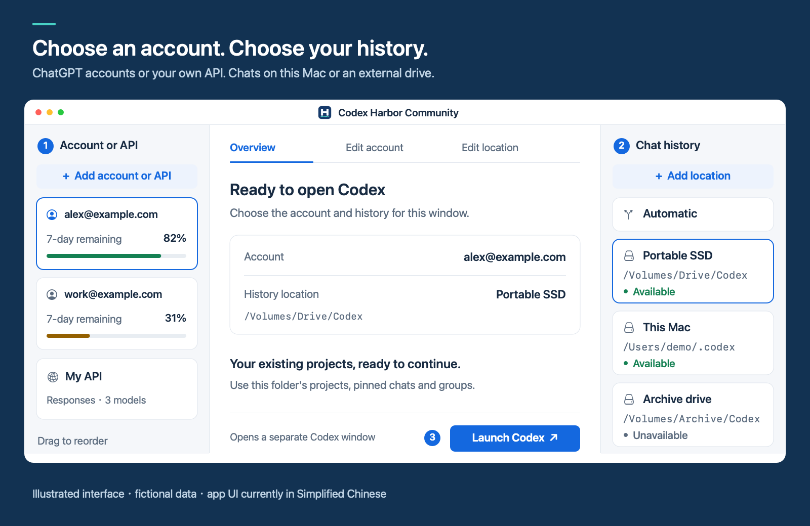
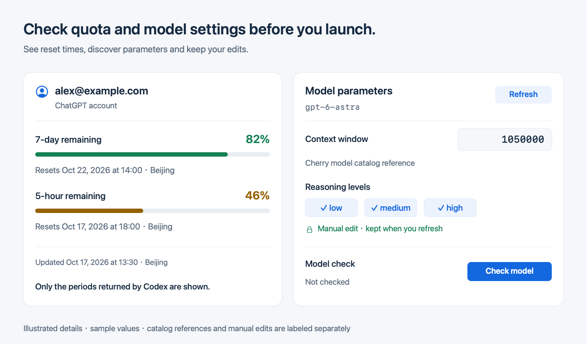

  

<h1 align="center">Codex Harbor Community</h1>

  <strong>Open Codex with the account and chat history you choose.</strong> 
  A native macOS launcher for your existing Codex desktop app.

  <a href="https://github.com/dongshuyan/codex-harbor-community/releases/latest"><strong>Download for macOS</strong></a> &nbsp;·&nbsp;
  <a href="#get-started">Get started</a> &nbsp;·&nbsp;
  <a href="docs/USAGE.md">User guide</a> &nbsp;·&nbsp;
  <a href="README.zh-CN.md">Chinese</a>

macOS 14+ &nbsp;·&nbsp; Free and open source &nbsp;·&nbsp; MIT

Interface illustration with fictional data. The app currently uses a Simplified Chinese interface.

## More accounts, the history you already have

Use a ChatGPT account or a Responses-compatible API with any registered Codex history folder. Continue the same chat when switching between an account and an API, or open separate windows for different work.

- **Keep accounts ready to use.** Sign in once per account. Open multiple Codex windows, including several from the same account, without signing out of the others.
- **Choose where your chats live.** Use a folder on your Mac or an external drive. Automatic selection follows your preferred order; manual selection is always available. Harbor leaves history in place.
- **See quota before you start.** Compare the remaining quota and reset dates returned for each ChatGPT account. Reset times currently use Beijing time (Asia/Shanghai).
- **Spend less time configuring models.** Context and reasoning settings fill in automatically, with their sources shown. Your manual edits survive refreshes. Check one model or all models in an API; checks may be billed.

Existing local projects, pinned chats, supported settings and skills carry over from the selected Codex folder. Models and permissions remain native Codex controls. After launch, you can close Harbor and keep working in Codex. [Shared history](docs/USAGE.md#windows-and-shared-history) · [Saved settings and skills](docs/USAGE.md#saved-codex-settings)

## Get started

You need **macOS 14+**, **Python 3.11+**, and the official **Codex desktop app** installed separately and opened at least once. Supported app names are `Codex.app` and `ChatGPT.app`.

1. **Install Harbor.** Download the app ZIP from [Releases](https://github.com/dongshuyan/codex-harbor-community/releases/latest), unzip it and move **Codex Harbor Community.app** to Applications. Checksums are available alongside the download.
2. **Add your two sources.** Use the left **+** to sign in with a ChatGPT account or configure your API. Use the right **+** to register your existing Codex data folder, such as `~/.codex`, or create a new one. Do not select a project's source-code folder as the history location.
3. **Choose both and launch.** Review the pairing, then open Codex. Choose your model inside the new window.

A fresh installation has **no saved accounts, API settings or paths**. The universal package includes Apple Silicon and Intel binaries; runtime testing covers Apple Silicon. Releases are ad-hoc signed, **not Apple-notarized**, so macOS may require approval on first launch.

Compatibility and everyday use

- APIs must support **Responses**. Harbor does not convert Chat Completions or Anthropic Messages.
- History locations remain independent; Harbor does not migrate, merge or automatically synchronize them. Finish a turn before continuing the same conversation in another window.
- Choose a local folder even when an external drive is connected. Close windows using an external drive before ejecting it.
- Before updating Codex through its native menu, finish your work and quit the other Codex instances. After the update, reopen your account and history pairing from Harbor. The updater’s automatic relaunch does not preserve Harbor’s launch settings.
- Codex updates and individual API providers may need compatibility checks. A successful model check confirms a short reply, not every desktop feature.

See the [full guide](docs/USAGE.md) for installation, window behavior and [building from source](docs/USAGE.md#build-and-compatibility).

## Your configuration stays under your control

API keys are stored in **macOS Keychain**. Official login files use user-only file permissions; names, URLs, model mappings and paths are local files, **not encrypted**. Community keeps its own data folder and has no configuration-upload, account-sync or analytics service.

Requests go to the account or API you select. Continuing a conversation through an API also sends its history context to that provider. [Privacy and storage details →](PRIVACY.md)

## Credits and community

Built with model data from **OpenAI Codex**, **Cherry Studio's provider registry** and **OpenRouter**, and configuration editing with **TOML Kit**. See [credits](CREDITS.md) for the projects and native interaction patterns we learned from, and [third-party notices](THIRD-PARTY-NOTICES.md) for retained licenses.

Thanks to **[LINUX DO](https://linux.do/)** and its community for sharing open-source work and feedback.

[Report an issue](https://github.com/dongshuyan/codex-harbor-community/issues) · [Contribution guide](CONTRIBUTING.md) · [MIT license](LICENSE)

Please use synthetic examples in reports; never attach keys, login files or private data folders. Codex Harbor Community is an independent project, not affiliated with or endorsed by OpenAI.
