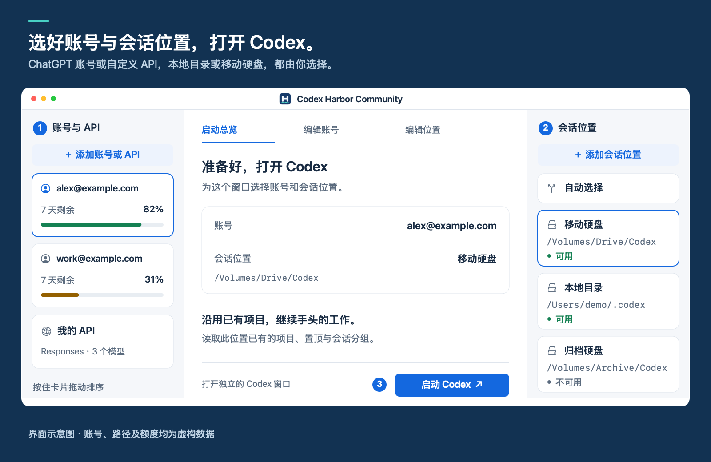
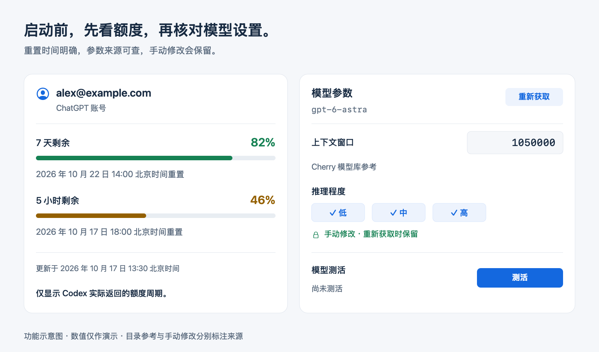

  

<h1 align="center">Codex Harbor Community</h1>

  <strong>选好账号和会话位置，打开你熟悉的 Codex。</strong> 
  为已有的 Codex 桌面应用提供多账号、多会话位置管理的原生 macOS 启动器。

  <a href="https://github.com/dongshuyan/codex-harbor-community/releases/latest"><strong>下载 macOS 版</strong></a> &nbsp;·&nbsp;
  <a href="#快速开始">快速开始</a> &nbsp;·&nbsp;
  <a href="docs/USAGE.md">使用指南（英文）</a> &nbsp;·&nbsp;
  <a href="README.md">英文版</a>

macOS 14+ &nbsp;·&nbsp; 免费开源 &nbsp;·&nbsp; MIT 许可

依据应用布局绘制的示意图。账号、路径与额度均为虚构数据；应用目前使用简体中文界面。

## 多个账号，沿用已有会话

ChatGPT 账号或兼容 Responses 的 API，都可以搭配已登记的 Codex 会话目录。账号和 API 之间切换时，可以继续同一条会话；也可以打开多个窗口，分别处理不同的工作。

- **账号随时可用。** 每个账号授权一次即可保留登录。同一账号或不同账号都能打开多个 Codex 窗口，无需退出其他窗口的登录。
- **会话放在哪里，由你决定。** 本地目录和移动硬盘都能使用。自动选择按你排列的优先级查找可用位置，也能随时手动指定。历史保留在原处。
- **启动前看清额度。** 对比各 ChatGPT 账号实际返回的剩余额度与重置时间，重置时间目前统一显示为北京时间。
- **少填一些模型参数。** 自动补齐上下文与推理设置，并标明来源；手动改过的内容不会被重新获取覆盖。支持单模型或全部模型测活，测活可能产生费用。

所选 Codex 目录中的本地项目、置顶、受支持的设置与技能会继续沿用。模型和权限仍在 Codex 原生菜单中选择。启动后可以关闭 Harbor，继续在 Codex 中工作。详见[共享历史](docs/USAGE.md#windows-and-shared-history)与[设置、技能](docs/USAGE.md#saved-codex-settings)说明（英文）。

## 快速开始

需要 **macOS 14 或以上**、**Python 3.11 或以上**，以及另行安装并至少打开过一次的官方 **Codex 桌面应用**。支持的应用名称为 `Codex.app` 和 `ChatGPT.app`。

1. **安装 Harbor。** 从[发布页](https://github.com/dongshuyan/codex-harbor-community/releases/latest)下载应用压缩包，解压后将 **Codex Harbor Community.app** 放进“应用程序”文件夹。同页提供校验文件。
2. **添加两侧来源。** 左侧点 **+**，授权 ChatGPT 账号或配置自己的 API；右侧点 **+**，登记已有的 Codex 数据目录（例如 `~/.codex`），或新建一个目录。会话位置应选择 Codex 数据目录，不是项目的代码文件夹。
3. **选好组合并启动。** 核对账号与会话位置，打开 Codex，再在新窗口里选择具体模型。

首次安装**没有任何已保存的账号、API 设置或路径**。通用安装包包含 Apple 芯片与 Intel 版本，实际运行测试使用 Apple 芯片。发行包采用临时签名，**未经过 Apple 公证**，首次打开时可能需要系统授权。

兼容性与日常使用说明

- API 必须支持 **Responses** 协议。Harbor 不转换 Chat Completions 或 Anthropic Messages 协议。
- 各位置的历史独立保存，不迁移、不合并、不自动同步。同一会话换窗口续聊前，请先结束上一轮生成。
- 插着移动硬盘时，仍可手动选择本地目录。弹出硬盘前，请先关闭正在使用它的窗口。
- Codex 更新后、使用不同 API 服务商时，可能需要重新核对兼容性。测活通过表示完成了一次短回复，不代表所有桌面功能均已验证。

完整安装、多窗口与[源码构建说明](docs/USAGE.md#build-and-compatibility)见[使用指南（英文）](docs/USAGE.md)。

## 配置由你掌握

API 密钥保存在 **macOS 钥匙串**中；官方登录文件由仅当前用户可访问的文件权限保护。名称、地址、模型映射和路径保存在本机文件中，**未加密**。社区版使用独立数据目录，没有配置上传、账号同步或分析统计服务。

模型请求发往你选中的账号或 API。通过 API 继续已有会话时，历史上下文也会发送给该服务商。详见[隐私与存储说明（英文）](PRIVACY.md)。

## 致谢与社区

模型数据来自 **OpenAI Codex**、**Cherry Studio 服务商注册表**与 **OpenRouter**，配置编辑使用 **TOML Kit**。参考项目与原生交互方案见[完整致谢（英文）](CREDITS.md)，相关许可见[第三方声明（英文）](THIRD-PARTY-NOTICES.md)。

感谢 **[LINUX DO](https://linux.do/)** 及其社区的开源分享与反馈。

[报告问题](https://github.com/dongshuyan/codex-harbor-community/issues) · [贡献指南（英文）](CONTRIBUTING.md) · [MIT 许可](LICENSE)

反馈请使用虚构示例，不要附上密钥、登录文件或私人数据目录。Codex Harbor Community 是独立项目，与 OpenAI 没有关联或背书关系。
