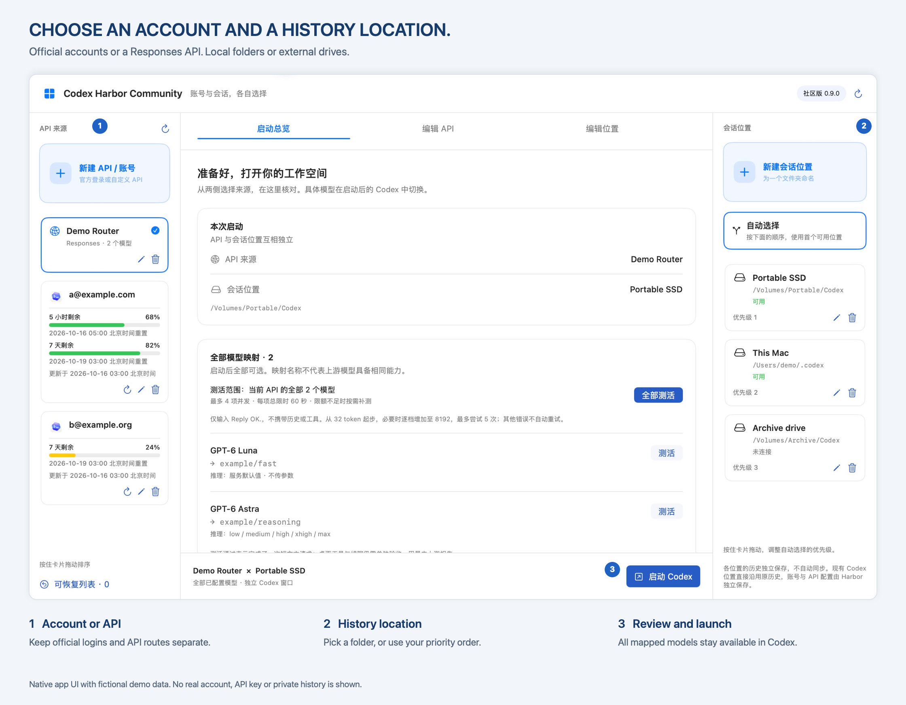
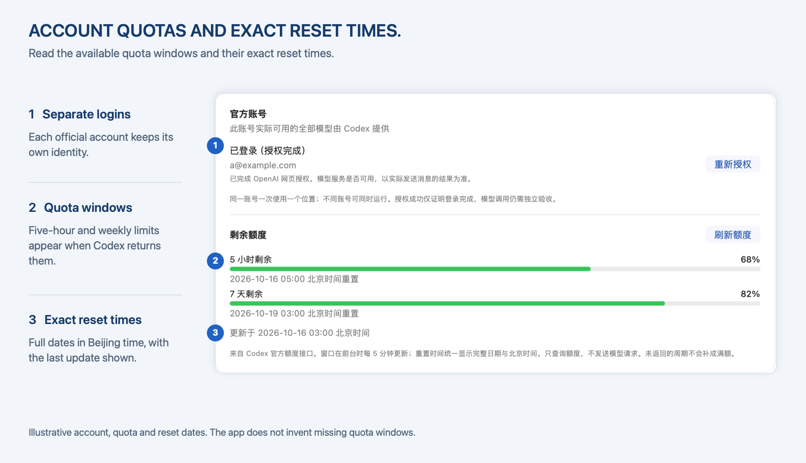
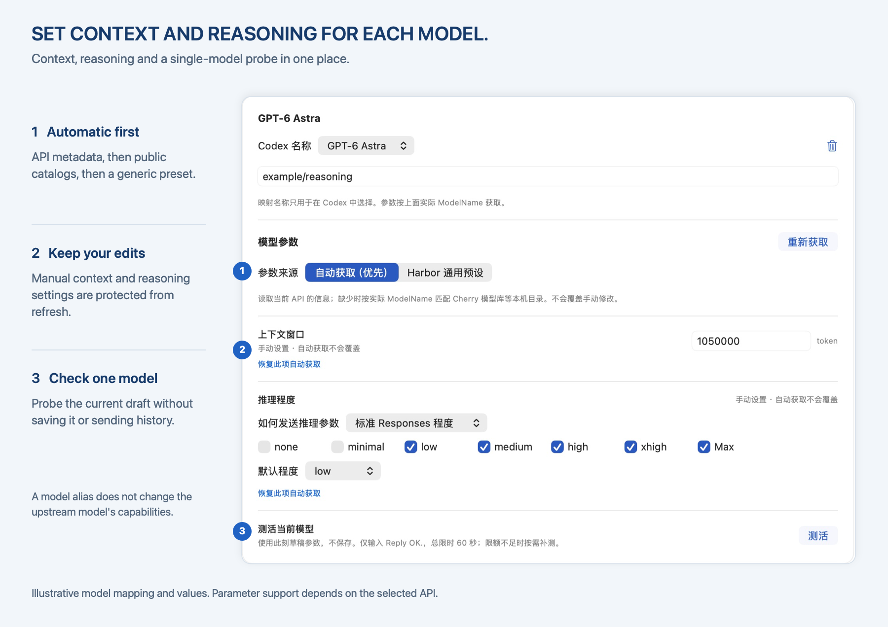

<p align="center">
  
</p>

<h1 align="center">Codex Harbor Community</h1>

<p align="center">
  <strong>账号与会话位置，各自选择。</strong><br>
  为官方账号和 Responses API 提供独立配置的原生 macOS Codex 启动器。
</p>

<p align="center">
  <a href="https://github.com/dongshuyan/codex-harbor-community/releases/latest"><strong>下载 macOS 版</strong></a> ·
  <a href="#快速开始">快速开始</a> ·
  <a href="docs/USAGE.md">详细指南（英文）</a> ·
  <a href="README.md">English</a>
</p>

<p align="center">macOS 14+ · Apple Silicon 与 Intel · MIT 开源许可</p>



> 配图来自真实原生界面，使用虚构的演示数据，并添加英文标注。账号、URL、路径、模型映射和额度数值均为示例；App 当前使用简体中文界面。

## 两个维度，独立选择

左侧选择官方账号或自己的 API，右侧选择保存 Codex 历史的文件夹，在中间核对后打开独立 Codex 窗口。

| 功能 | 可以做什么 |
| --- | --- |
| 官方账号 | 通过 OpenAI 网页授权登录，不同账号独立保存。显示 Codex 实际返回的额度周期。 |
| 自定义 API | 配置 Responses 基础 URL、API Key 与多个模型映射，启动时启用全部映射。 |
| 会话位置 | 登记本地目录或移动硬盘；手动选择，或按优先级使用首个可用位置。按住卡片拖动排序。 |
| 工作区分组 | 读取所选原生 Codex home 中的本地项目、会话分组、置顶与顺序。 |
| 模型参数 | 自动补齐上下文与推理设置，标明来源，保护手动修改。支持单模型或当前 API 全部模型测活。 |
| 原生 Codex 窗口 | 模型和权限仍在 Codex 自己的菜单中选择。不同账号、API 可以同时运行。 |

## 快速开始

### 安装

1. 从 [Releases](https://github.com/dongshuyan/codex-harbor-community/releases/latest) 下载通用 App ZIP，同页提供 `SHA256SUMS` 校验文件。
2. 解压，将 **Codex Harbor Community.app** 放进 Applications 文件夹。
3. 打开 Harbor，添加自己的来源。**首次安装没有账号、API 配置或已登记的历史路径。**

运行要求：

- **macOS 14 或以上。** 通用安装包包含 Apple Silicon 与 Intel 可执行文件；实际运行验收使用 Apple Silicon，尚未在实体 Intel Mac 上验证。
- **已安装官方 Codex 桌面 App。** 支持 `/Applications` 或用户 Applications 文件夹中的 `Codex.app`、`ChatGPT.app`。使用 Harbor 前，先打开官方 App 一次。Harbor 安装包不包含 Codex 本体。
- **Python 3.11 或以上。** 支持 python.org 或 Homebrew 安装，无需额外 Python 包。

当前发行包使用本机 ad-hoc 签名，**未经过 Apple Developer ID 签名或公证**；macOS 可能需要用户批准后才能打开。

### 配置并启动

1. **添加账号或 API。** 点击左侧 **＋**，选择官方账号并在浏览器授权；或填写自己的 Responses URL、API Key 和模型映射。
2. **添加会话位置。** 点击右侧 **＋**，为文件夹起名并登记绝对路径。可以选择已有原生 Codex home，也可以明确创建新目录。
3. **选好两侧并启动。** 在中间核对组合，点击启动；具体使用哪个模型，在新打开的 Codex 窗口内选择。

登记或移除位置都不会移动、删除历史。插上移动硬盘后，仍可手动使用本地；不同位置之间不会自动同步。

## 账号和额度，一眼看清



直接查看账号身份、服务返回的额度周期及重置时间。没有返回或已经过期的数据会明确标识。重置时间统一显示完整日期与 **Asia/Shanghai（北京时间）**；查询额度不发送模型请求。

同一个官方账号或 API 可以同时打开多个窗口，各自选择相同或不同的会话位置。换窗口续聊前先结束上一轮，避免同时编辑同一会话；共享历史列表有时需要重新打开目标窗口才会更新。详见[多窗口与历史说明](docs/USAGE.md#windows-and-shared-history)。

## 模型参数可追溯，也可手动调整



先读取当前 API 的信息，缺少时参考内置公开模型库，未知模型使用通用预设。上下文、推理程度均可调整，重新获取不会覆盖手动修改。模型库数值只是参考；映射名称不会改变上游模型的实际能力。

**目前仅支持 Responses 协议**，不提供 Chat Completions 或 Anthropic Messages 协议转换。测活由用户明确触发，使用有限 token 预算，每个模型总限时 60 秒，可能产生费用。测活通过表示完成了一次短回复，桌面工具和续聊仍需独立验证。详见[参数与测活说明](docs/USAGE.md#model-parameters-and-probes)。

## 私人配置保存在自己的 Mac

- API Key 存入专用 **macOS 钥匙串**，不会退回到配置 JSON 中明文保存。
- 官方登录使用独立的 Codex 原生凭据文件，通过文件系统权限保护。
- 名称、URL、映射与路径保存在本机数据目录。Harbor 本身没有配置上传、账号同步或分析统计服务。
- 模型请求发往选中的账号或 API。通过 Router 继续历史会话时，历史上下文会发送给该服务商。

社区版的数据根目录是 `~/Library/Application Support/Codex Harbor Community/`，首次启动没有账号或路径。选择已有 Codex 目录后，会沿用其中不涉及账号和路由的设置及技能，并保留 Harbor 窗口中的手动修改。详情见[隐私与凭据存储说明](PRIVACY.md)。

## 从源码构建

需要 Swift 6 工具链和 Python 3.11+：

```sh
python3 -B -m unittest discover -s tests -p 'test_*.py'
python3 -B build.py --community --universal
```

产物位于 `release-artifacts/`。正常退出或处理构建错误时会清理临时 App；清理失败会报告剩余路径。若进程被强制终止，下次构建只回收本工具创建且已无活动构建占用的临时目录。构建不会安装 App，也不读取个人配置。另见[构建与兼容性说明](docs/USAGE.md#build-and-compatibility)及[贡献流程](CONTRIBUTING.md)。

## 致谢

Harbor 的模型数据来自 [OpenAI Codex](https://github.com/openai/codex) 和 [Cherry Studio provider-registry](https://github.com/CherryHQ/cherry-studio/tree/d33b9b0266bda30d0e4715ae16650eee7b845d70/packages/provider-registry)，并使用 OpenRouter 的公开上下文参考数据。设计与兼容性调研参考了 CC Switch、CodexBar、Cockpit Tools、CodeEdit，以及原生 AppKit 拖放示例。

各项贡献、侧栏交互参考和上游许可见[完整致谢](CREDITS.md)。特别感谢 **[LINUX DO](https://linux.do/)** 及其社区，为开源作品的分享、交流和反馈提供空间。

## 反馈与许可

通过 [GitHub Issues](https://github.com/dongshuyan/codex-harbor-community/issues) 提交可复现问题，附上 App、Codex 版本和虚构示例。不要上传 Key、登录文件或整个数据文件夹。

Harbor 原创代码采用 [MIT 许可](LICENSE)，内置公开模型数据保留各自的[上游许可与声明](THIRD-PARTY-NOTICES.md)。

Codex Harbor Community 是独立项目，与 OpenAI 没有关联或背书关系。
